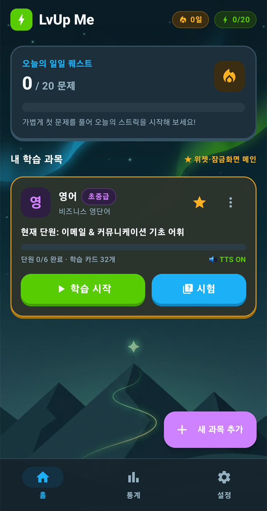
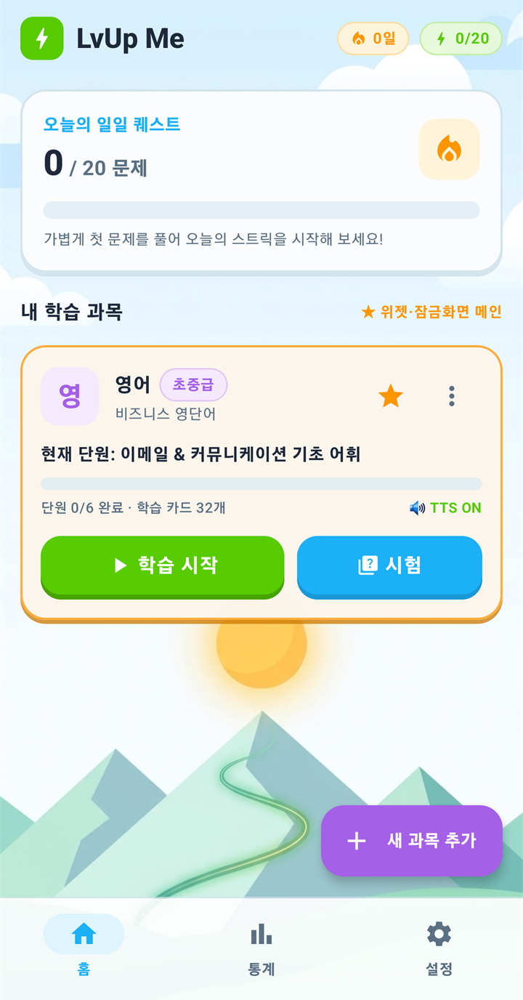

# LvUp Me

AI 맞춤형 커리큘럼과 저용량·고반복 마이크로 학습을 결합한 **개인용 Android 학습 앱**입니다.  
Gemini API를 활용해 원하는 과목의 레벨 테스트·커리큘럼·퀴즈를 생성하고, 홈 위젯과 잠금화면 카드까지 연동해 일상 속 짧은 틈새 시간에 반복 학습할 수 있도록 설계했습니다.

---

## 스크린샷

<p align="center">
  <table>
    <tr>
      <th align="center">다크 모드 (Aurora Peaks)</th>
      <th align="center">라이트 모드 (Sunny Peaks)</th>
    </tr>
    <tr>
      <td align="center">
        
      </td>
      <td align="center">
        
      </td>
    </tr>
  </table>
</p>

---

## 주요 기능

- **AI 온보딩 & 레벨 테스트**: AI와 대화하며 학습 과목·세부 주제를 정하고, 간단한 레벨 테스트를 거쳐 수준별 다단원 커리큘럼과 학습 카드를 자동 생성합니다.
- **고반복 퀴즈 루프 (5:1 / 7:3 전략)**
  - 현재 단원 학습과 과거 단원 복습을 기본 **5:1 비율**로 섞어 장기 기억을 유지합니다(설정에서 조정 가능).
  - 과거 복습 문제는 **오답률 × 경과 시간 × SRS 복습 예정일** 가중치로 우선 출제됩니다.
  - **객관식(7) : 3단어 이내 단답형(3)** 비율로 가볍고 빠르게 풀 수 있으며, 오답 시 해설 제공 및 반복 오답 시 AI 약점 보강 카드를 자동 생성합니다.
- **단원 체크포인트 & 과거 단원 다시 학습**: 단원별 100% 완료 화면에서 체크포인트 시험으로 다음 단원을 해금하고, 커리큘럼 단원 목록에서 완료한 과거 단원을 골라 기존 진도를 유지한 채 한 바퀴 집중 복습하거나 시험을 재응시할 수 있으며, 전 범위 AI 종합 모의고사도 응시할 수 있습니다.
- **홈 위젯 & 잠금화면 집중 모드**
  - 메인 과목 1개를 지정해 **홈 화면 Glance 위젯**, **잠금화면 알림 카드**, **전용 잠금화면 학습 화면**(화면 켜짐 연동 + 미니 퀴즈)에서 바로 복습할 수 있습니다.
- **로컬 우선 설계 & 보안**
  - Gemini API 키는 사용자가 앱 **설정**에서 직접 입력하며, **Android Keystore (AES-256-GCM)**로 기기 내부에만 암호화 저장됩니다.
  - Wi-Fi 환경 백그라운드 프리페치, TTS 자동 발음/속도 조절, 다크/라이트/시스템 테마 전환, **JSON 학습 데이터 백업/복원**을 지원합니다.

---

## 기술 스택

| 영역 | 기술 |
| --- | --- |
| Language & UI | Kotlin, Jetpack Compose, Material 3 (Custom Gamified Components) |
| Database & Storage | Room (SQLite), DataStore Preferences, Android Keystore (`AES/GCM/NoPadding`) |
| Background & Widget | WorkManager, Jetpack Glance (`AppWidget`), Foreground Service & BroadcastReceiver |
| AI & Network | Gemini REST API (`v1beta`), OkHttp, Kotlinx Serialization |
| Speech | Android `TextToSpeech` |
| Minimum / Target SDK | `minSdk 26` (Android 8.0) / `compileSdk 35` / `targetSdk 35` (Android 15) |

---

## 프로젝트 구조

```text
app/src/main/java/com/lvupme/app/
├── LvUpMeApp.kt      # Application 진입점 및 수동 DI 컨테이너(AppContainer)
├── MainActivity.kt   # 단일 Activity 호스트 및 딥링크 라우팅
├── data/
│   ├── local/        # Room Entity, DAO, Database, KeystoreCrypto, SettingsRepository, BackupManager
│   ├── remote/       # GeminiClient, AiDtos, GeminiResponseParser
│   └── repository/   # LearningRepository (커리큘럼·퀴즈·시험·약점 보강 오케스트레이션)
├── domain/           # SrsScheduler, AnswerGrader, TtsHelper
├── lockscreen/       # LockScreenService, BootReceiver
├── notification/     # NotificationHelper, NotificationActionReceiver
├── ui/
│   ├── components/   # 공용 UI 컴포넌트 (CurriculumUnitsBottomSheet)
│   ├── home/         # 홈 대시보드 (일일 퀘스트, 과목 카드, 메인 과목 지정)
│   ├── onboarding/   # AI 온보딩 채팅, 레벨 테스트
│   ├── study/        # 퀴즈 학습 루프 (객관식/단답형, 힌트/해설, TTS)
│   ├── exam/         # 단원 체크포인트 및 AI 종합 모의고사
│   ├── stats/        # 학습 통계, 취약 개념 목록, 시험 이력
│   ├── settings/     # API 키·모델 선택, 학습 비율, 위젯/잠금화면, 백업/복원
│   ├── lockscreen/   # LockScreenActivity (전용 잠금화면 학습 카드 + 미니 퀴즈)
│   ├── navigation/   # LvUpNavGraph (화면 라우팅)
│   ├── theme/        # Theme, GamifiedComponents (TactileButton, LvUpBackground 등)
│   └── viewmodel/    # 화면별 ViewModel 및 팩토리
├── widget/           # Jetpack Glance 홈 위젯 (LvUpWidget)
└── worker/           # PrefetchWorker, LockScreenCardWorker, ReminderWorker, WorkScheduler
```

---

## 빌드 및 실행 방법

### 1. 사전 준비
- JDK 17 이상 (JDK 21 호환)
- Android SDK (API 35)
- Google AI Studio에서 발급한 **Gemini API 키** (앱 설치 후 **설정** 화면에서 입력)

### 2. 디버그 빌드 & 테스트
```bash
./gradlew testDebugUnitTest assembleDebug
```

### 3. 릴리스 빌드 (서명 필요)
프로젝트 루트에 개인 키스토어와 `keystore.properties`(Git 추적 제외)를 준비한 뒤 빌드합니다.

```properties
# keystore.properties (예시 - Git에 커밋하지 마세요)
storeFile=lvupme-release.jks
storePassword=YOUR_STORE_PASSWORD
keyAlias=lvupme
keyPassword=YOUR_KEY_PASSWORD
```

```bash
./gradlew testDebugUnitTest assembleRelease
```

---

## 설치 및 초기 설정

1. [GitHub Releases](https://github.com/ggumtakg/lvup-me/releases)에서 최신 Release APK(`LvUpMe-v1.1.0-release.apk`)를 다운로드해 Android 기기에 설치합니다.
2. 앱 실행 후 **설정 → Gemini API 설정**에서 본인의 API 키를 입력하고 **모델 목록 불러오기**로 사용할 모델(예: `gemini-2.5-flash`)을 선택합니다.
3. 홈 화면의 **새 과목 추가**를 눌러 AI와 함께 첫 학습 커리큘럼을 생성합니다.

---

## 라이선스

이 프로젝트는 [MIT License](LICENSE)로 배포됩니다.

